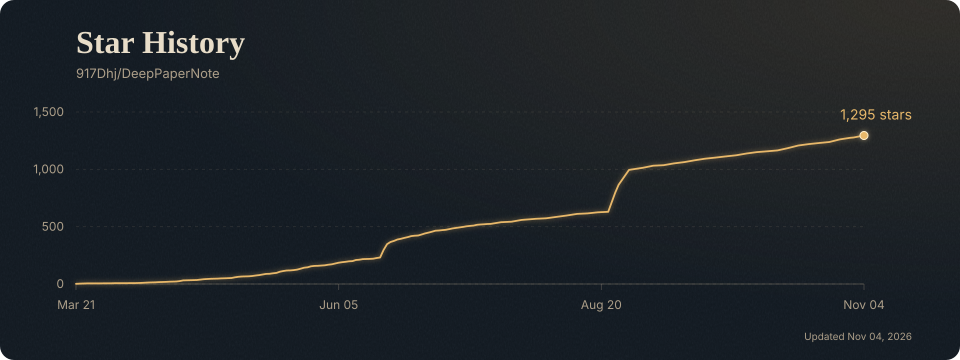

<div align="center">

# DeepPaperNote

**Turn one complex paper into an Obsidian note you will actually want to keep.**

[English](./README.md) | [简体中文](./README.zh-CN.md)

[](https://917dhj.github.io/DeepPaperNote/)
[](https://github.com/917Dhj/DeepPaperNote/releases)
[](./LICENSE)
[](./skills/deeppapernote/SKILL.md)
[](./skills/deeppapernote/references/obsidian-format.md)

</div>

[](https://917dhj.github.io/DeepPaperNote/)

<p align="center">
  <em>Read one paper deeply. Add one durable page to your academic wiki.</em>
</p>

**When you study an important paper, the hard part is rarely the reading. It is turning what you understood into a note you can still use later.** Finding the source, matching figures to the text, copying numbers over, and tracing the method often take the better part of a day. And the papers you have read end up scattered, with nothing connecting one to another.

DeepPaperNote is an agent skill that runs in Claude Code, Codex, and any other agent that supports skills. Hand it a paper, and it reads the full text, writes an illustrated deep-reading note, saves it into your Obsidian vault, and links it to the other papers you have read. **Every paper you read grows your academic wiki a little.**

- 🚀 **One sentence, one note.** No prompts to learn and no templates to set up. Say "Generate a deep-reading note for this paper" with a title, DOI, arXiv ID, or PDF, and the rest happens on its own: finding the source, reading the full text, extracting figures, writing the note, and saving it into your vault. The first time, it asks you two things: which language to write in, and where to save.
- 🎓 **Reads like a domain expert.** A method paper, a benchmark, a survey, and a clinical trial call for very different questions, so DeepPaperNote has a dedicated way of reading each of 10 paper types. From CS and AI to medicine, biology, physics, psychology, the social sciences, and the humanities, and from new methods, systems, and theory to benchmarks, surveys, and clinical trials, your papers can all go to DeepPaperNote. These readings draw on more than 50 reviewer guidelines, reporting standards, and reading methods, including the NeurIPS, ICLR, and ACL review criteria, reporting standards such as CONSORT and PRISMA, Keshav's three-pass method, and open-source AI reviewing projects and paper skills. They were tested again and again on 34 real papers from many disciplines.
- 🎯 **Accurate and complete.** Every conclusion in the note traces back to the paper, numbers come straight from its text and tables, and every main experiment is covered. When the paper does not report something, the note says so plainly instead of guessing for the authors. Before saving, an independent review checks the note for errors and omissions. If only the abstract is available and the full text cannot be read, it stops and asks you for the paper rather than writing a note anyway.
- 🖼️ **Figures, tables, and formulas in the text.** Figures and tables are cropped from the original PDF and placed where the text discusses them, right next to the explanation; key formulas are written in LaTeX and render directly in Obsidian. You no longer have to flip back to the PDF while reading the note.
- 🧠 **A vault that knows you better the more you use it.** Each new note links to related papers already in your vault, goes into the domain folders you already use, and carries structured properties you can filter and query with Obsidian Bases. Once you record your research directions with research memory, each note's Takeaways tell you what the paper means for your own research. The more you read and the fuller your memory, the closer its connections and suggestions fit you.

## 📰 News

- **[v3.0.0]** 🎓 Notes read each paper by its type: 10 paper types each get their own way of reading and note structure, every figure is visually reviewed before it enters the note, and an independent quality review runs before saving. [Release notes](https://github.com/917Dhj/DeepPaperNote/releases/tag/v3.0.0)
- **[v3.0.0]** 🧠 Every note joins your vault: notes gain Takeaways and Connections sections and carry structured properties, and two new skills, [`research-memory`](./skills/research-memory/README.md) and [`organize-wiki`](./skills/organize-wiki/README.md), tailor the takeaways to your research directions and keep your domain folders in order.
- **[v2.3.1]** 🔌 Added support for [DeepPaperNote Connector](https://github.com/917Dhj/DeepPaperNote-Connector): papers you save from your browser can get their notes in the same paper directory. [Release notes](https://github.com/917Dhj/DeepPaperNote/releases/tag/v2.3.1)

News lists only the three most recent user-facing milestones. See the [changelog](./CHANGELOG.md) and [GitHub Releases](https://github.com/917Dhj/DeepPaperNote/releases) for the full history.

## 🚀 Quick Start

### 1. Install

**Claude Code**: install from the plugin marketplace

```bash
claude plugin marketplace add 917Dhj/DeepPaperNote
claude plugin install deeppapernote@deeppapernote
```

**Codex and other agents that support skills**: install with the skills CLI

```bash
npx skills add 917Dhj/DeepPaperNote
```

The plugin installs all four skills at once. The skills CLI lets you choose which skills to install and which agents receive them. To try it out, `deeppapernote` alone is enough; see [below](#-from-paper-to-wiki) for what the other three do.

### 2. Install the PDF dependency

```bash
python3 -m pip install PyMuPDF
```

Python 3.10 or newer is required. If you use `uv`, run `uv pip install PyMuPDF` in the Python environment DeepPaperNote will use.

### 3. Read a paper

Tell your agent in one sentence, with the paper's title, DOI, URL, arXiv ID, or local PDF:

```text
Generate a deep-reading note for this paper: <paper>
Turn this paper into an Obsidian note: <paper>
```

You can also call it with the slash command `/deeppapernote <paper>`.

The first time, it asks you two things: whether notes should be in English or Chinese, and whether to save them in the current workspace or your Obsidian vault. It remembers your answers and does not ask again. To use a different language or location for one paper, just say so in the request. For environment variables and other settings, see [User Configuration](./skills/deeppapernote/references/user-configuration.md).

### 4. Update to a new version

**Claude Code**:

```bash
claude plugin marketplace update deeppapernote
claude plugin update deeppapernote@deeppapernote
```

Restart Claude Code to apply the update.

**skills CLI**:

```bash
npx skills update
```

## 👀 What a Note Looks Like


Every note has three parts: the opening and closing are the same for every paper, and the body in between follows the paper's type.

| Part | Sections |
| --- | --- |
| **Opening** | Core Information · Abstract · Contributions · One-Sentence Summary |
| **Body** | Method paper: Background and Problem → Limitations of Prior Work → Key Idea and Challenges → Method → Experimental Evidence → Deep Analysis<br>Benchmark: Evaluation Gap → Task and Design Goals → Construction and Quality Control → Evaluation Framework → Findings → What It Really Measures<br>Survey: Scope and Search → Taxonomy → Directions → Consensus, Disagreement, and Gaps<br>…10 paper types in all |
| **Closing** | Limitations · Takeaways · Connections · My Notes |

The closing sections are where the note meets your vault:

- **Takeaways**: Transferable Ideas and Next Steps, covering which of the paper's ideas carry over to other problems and what to do after reading it. Once you set up research memory, this part is written against your own research directions.
- **Connections**: links to related paper notes in your vault, and the key prior work you need to understand this paper.
- **My Notes**: yours to write in, and kept exactly as it is when the note is regenerated.

<details>
<summary><b>What appears in your vault after saving</b></summary>

Each paper gets its own folder, and figures and tables are named after their labels in the paper:

```text
<your papers folder>/
└── NLP/                       ← domain folder, reusing the ones you already have
    └── Attention_Is_All_You_Need/
        ├── Attention_Is_All_You_Need.en.md
        └── images/
            ├── figure_1.png
            └── table_2.png
```

Each note opens with structured properties you can query and filter with Obsidian Bases, for example to list every benchmark paper you have read, or everything you read this month:

```yaml
paper_type: benchmark_or_dataset
methods: [...]
datasets: [...]
tasks: [...]
read_date: 2026-11-08
```

</details>

## 🧩 From Paper to Wiki

DeepPaperNote reads each paper deeply and saves it well. The other three skills are optional companions that look after your vault as a whole.

| Skill | What it does for you | How to call it |
| --- | --- | --- |
| [`deeppapernote`](./skills/deeppapernote/SKILL.md) | **Core.** Deep-reads one paper and saves an illustrated note into your vault, linked to the other papers you have read. | "Generate a deep-reading note for this paper: <paper>"<br>or `/deeppapernote` |
| [`research-memory`](./skills/research-memory/README.md) | Keeps a research memory for you: it records the research directions you are working on and follows them as you read. With it, DeepPaperNote writes each note's Takeaways against your directions, so the next note knows you better. | "Build my research memory"<br>or `/research-memory` |
| [`organize-wiki`](./skills/organize-wiki/README.md) | Organizes your vault: it sorts out the domain categories, moves papers filed under the wrong domain, and fixes their domain tags. The categories it settles become what DeepPaperNote follows when it files new papers. | "Organize my paper library"<br>or `/organize-wiki` |
| [`paper-glossary`](./skills/paper-glossary/README.md) | Builds a glossary for your vault: it turns a paper's key concepts into reusable term notes and links them back into the paper's text. The same term in different papers points to the same term note. | "Build glossary notes for this paper"<br>or `/paper-glossary` |

A good rhythm: read a few papers with DeepPaperNote first; once your vault has some notes, build a research memory; when the papers pile up and the categories start to drift, organize the vault.

## ✅ Notes You Can Trust

- **A deep read, not a summary.** Every note answers all the core questions of its paper type, and states plainly where the paper does not report something.
- **Grounded in the paper.** Conclusions and numbers in the note come from the paper itself, with nothing invented or guessed.
- **No full text, no note.** If only the abstract is available, it stops and asks you for the paper instead of handing over a note that only looks complete.
- **Every figure is checked.** Each figure and table is visually reviewed before it enters the note; a crop that is incomplete or does not match the text stays out.
- **A final check before saving.** An independent review checks the note for errors and omissions, and the note is fixed before it is saved.
- **Your existing notes are safe.** An existing note is never silently overwritten, and regenerating a note keeps its My Notes section exactly as it is.

**More than words:** we run regression tests on 34 real papers covering all 10 paper types, and in a blind evaluation on 6 sample papers with our internal rubric, the average score rose from 73.6 to 84.2 (out of 100) after the type-specific redesign.

## 🔧 Optional Enhancements

DeepPaperNote reads ordinary digital PDFs without any of these. Add them as you need:

| Enhancement | What it does for you | How to turn it on |
| --- | --- | --- |
| **[DeepPaperNote Connector](https://github.com/917Dhj/DeepPaperNote-Connector)** | Saves a paper from your browser into your Obsidian paper library in one click, so its note can later be written in the same folder | Install the browser extension; it currently supports Chrome on macOS |
| **Zotero** | Uses the item and PDF already in your Zotero library, with no searching or downloading again | In Zotero 7, open Settings → Advanced and check "Allow other applications on this computer to communicate with Zotero"; it is used automatically from then on |
| **Semantic Scholar API key** | Finds the right title, authors, and venue even for papers that are hard to identify | Set the environment variable `SEMANTIC_SCHOLAR_API_KEY` |
| **OCR** | Recovers the text of scanned or poor-quality PDFs | Install Tesseract and `pytesseract` |

For any of these, you can also ask your agent to check your environment and set it up for you.

## 🛠️ Troubleshooting

When something goes wrong, the easiest fix is to ask your agent:

- **Installed, but it does not work**: say "Check DeepPaperNote's environment." It tells you what is missing, covering Python and PyMuPDF, your Obsidian settings, and optional enhancements such as Zotero and OCR.
- **A note stopped partway or was not saved**: say "Where did this DeepPaperNote run stop?" It tells you where it got stuck, what is missing, and what to do next.

Intermediate files are kept under `~/.deeppapernote/runs/`, one directory per paper, and are not cleaned up automatically. Delete them by hand if they take up too much space.

If that does not solve it, please [open an issue](https://github.com/917Dhj/DeepPaperNote/issues).

## 🧭 Inspirations

DeepPaperNote was influenced by projects that take paper reading, evidence extraction, and note generation seriously, especially:

- [heleninsights-dot/phd-deepread-workflow](https://github.com/heleninsights-dot/phd-deepread-workflow)
- [juliye2025/evil-read-arxiv](https://github.com/juliye2025/evil-read-arxiv)
- [HKUSTDial/Supervisor-Skills](https://github.com/HKUSTDial/Supervisor-Skills)

## 🤝 Contributing

Pull requests should target `develop`, not `main`. Before submitting, run the tests and lint locally:

```bash
python3 -m pip install -e '.[dev]'
python3 -m pytest -q -n auto
python3 -m ruff check skills tests
```

The workflow is defined in [`skills/deeppapernote/SKILL.md`](./skills/deeppapernote/SKILL.md). Changes that may affect note quality should be evaluated with [`evals/regression-workflow.md`](./evals/regression-workflow.md) and [`evals/note-quality-rubric.md`](./evals/note-quality-rubric.md).

## Star History

[](https://www.star-history.com/?repos=917Dhj%2FDeepPaperNote&type=date&legend=top-left)

<p align="center">
  <em>Thanks for reading, using, and supporting DeepPaperNote. May your paper-reading days be a little clearer, calmer, and more rewarding.</em>
</p>

<p align="center">
  <a href="./LICENSE">MIT License</a> &copy; <a href="https://github.com/917Dhj">917Dhj</a>
</p>
