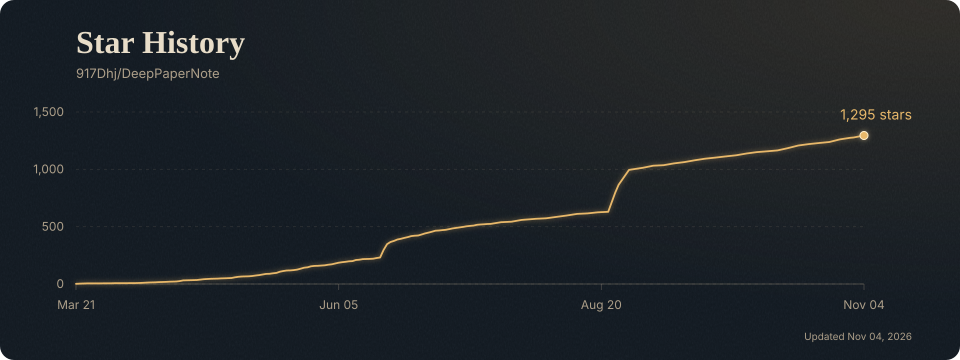

<div align="center">

# DeepPaperNote

**把一篇复杂论文，变成一篇真正值得长期保留的 Obsidian 笔记。**

[English](./README.md) | [简体中文](./README.zh-CN.md)

[](https://917dhj.github.io/DeepPaperNote/)
[](https://github.com/917Dhj/DeepPaperNote/releases)
[](./LICENSE)
[](./skills/deeppapernote/SKILL.md)
[](./skills/deeppapernote/references/obsidian-format.md)

</div>

[](https://917dhj.github.io/DeepPaperNote/)

<p align="center">
  <em>深读一篇论文，沉淀一页学术 Wiki。</em>
</p>

**精读一篇重要论文，最累的往往不是“看”，而是把读懂的东西整理成以后还用得上的笔记。** 找原文、对照图表、搬运数据、理清方法主线，一篇笔记常常要花掉大半天。而读过的论文散落各处，彼此之间没有任何联系。

DeepPaperNote 是一个 Agent Skill，可以运行在 Claude Code、Codex 等任何支持 skill 的 Agent 里。把一篇论文交给它，它会读完全文，写成一篇图文并茂的精读笔记，存进你的 Obsidian 知识库，并连到你读过的其他论文上。**每读一篇，你的学术 Wiki 就长大一点。**

- 🚀 **一句话，一篇笔记**：不用学提示词，也不用配模板。说一句“给这篇论文生成深度笔记”，附上标题、DOI、arXiv ID 或 PDF，剩下的全部自动完成：找原文、读全文、提取图表、写笔记、存进知识库。第一次使用时只需回答两个问题：笔记用什么语言，存到哪里。
- 🎓 **像领域专家一样读**：方法论文、Benchmark、综述和临床试验，该问的问题完全不同，DeepPaperNote 为 10 种论文类型各准备了一套专门的读法。从 CS/AI 到医学、生物、物理、心理、社科乃至人文，从新方法、系统、理论到 Benchmark、综述和临床试验，你的论文都可以交给它。这套读法参考了 50 多份审稿指南、报告规范和阅读方法，包括 NeurIPS、ICLR、ACL 的审稿标准，CONSORT、PRISMA 等医学与综述报告规范，Keshav 的三遍读法，以及开源的 AI 审稿项目和论文 skill，并在 34 篇横跨多个学科的真实论文上反复检验。
- 🎯 **写得准，写得全**：笔记里的结论都能在原文找到出处，数字直接取自论文的正文和表格，每个主要实验都会写到。论文没有报告的内容，笔记会直说“论文没有报告”，不替作者脑补。保存前还有一轮独立审阅，检查有没有写错、漏写。如果只拿到摘要、读不到全文，它会停下来向你要原文，而不是硬写一篇。
- 🖼️ **图、表、公式融进正文**：原文的插图和表格会被裁剪出来，放在正文讨论它的地方，紧挨着解读；关键公式用 LaTeX 写出，在 Obsidian 里直接渲染。读笔记时不用再回头翻 PDF。
- 🧠 **越用越懂你的知识库**：新笔记会自动链接到库里的相关论文，归入你已有的领域文件夹，还带着可以用 Obsidian Bases 筛选查询的结构化属性。记录下你的研究方向（研究记忆）之后，每篇笔记的“阅读收获”会告诉你，这篇论文对你自己的研究有什么用。你读得越多、记忆越完整，它给出的关联和建议就越贴近你。

## 📰 最新动态

- **[v3.0.0]** 🎓 笔记按论文类型来读：10 种论文类型各有专门的读法和笔记结构，图表先经过视觉审阅再放进笔记，保存前还有一道独立的质量审阅。[版本说明](https://github.com/917Dhj/DeepPaperNote/releases/tag/v3.0.0)
- **[v3.0.0]** 🧠 每篇笔记都连进你的知识库：笔记新增“阅读收获”和“关联”两节，并带结构化属性；新增 [`research-memory`](./skills/research-memory/README.md) 和 [`organize-wiki`](./skills/organize-wiki/README.md) 两个 skill，让阅读收获贴合你的研究方向，让领域文件夹保持整齐。
- **[v2.3.1]** 🔌 支持 [DeepPaperNote Connector](https://github.com/917Dhj/DeepPaperNote-Connector)：在浏览器里收藏的论文，可以直接在同一个论文目录里生成笔记。[版本说明](https://github.com/917Dhj/DeepPaperNote/releases/tag/v2.3.1)

这里只保留最近三条用户可感知的重要动态。完整历史请查看 [CHANGELOG](./CHANGELOG.md) 与 [GitHub Releases](https://github.com/917Dhj/DeepPaperNote/releases)。

## 🚀 快速开始

### 1. 安装

**Claude Code**：从插件市场安装

```bash
claude plugin marketplace add 917Dhj/DeepPaperNote
claude plugin install deeppapernote@deeppapernote
```

**Codex 及其他支持 skill 的 Agent**：用 skills CLI 安装

```bash
npx skills add 917Dhj/DeepPaperNote
```

插件方式会一次装上全部四个 skill。skills CLI 会让你选择装哪些 skill、装到哪些 Agent。只想先试试的话，装 `deeppapernote` 一个就够了，另外三个的用途见[下文](#-从论文到知识库)。

### 2. 安装 PDF 依赖

```bash
python3 -m pip install PyMuPDF
```

需要 Python 3.10 或更高版本。用 `uv` 的话，执行 `uv pip install PyMuPDF`，装到 DeepPaperNote 实际使用的那个 Python 环境里。

### 3. 开始读论文

对你的 Agent 说一句话，附上论文的标题、DOI、URL、arXiv ID 或本地 PDF：

```text
给这篇论文生成深度笔记：<论文>
把这篇论文整理成 Obsidian 笔记：<论文>
```

也可以直接用斜杠命令 `/deeppapernote <论文>` 调用。

第一次使用时，它会问你两件事：笔记用中文还是英文，存到当前工作区还是你的 Obsidian 库。选好之后会记住，以后不再问。某一篇想换语言或换位置，直接在请求里说就行。环境变量等更多配置见[用户配置说明](./skills/deeppapernote/references/user-configuration.md)。

### 4. 更新到新版本

**Claude Code**：

```bash
claude plugin marketplace update deeppapernote
claude plugin update deeppapernote@deeppapernote
```

更新后重启 Claude Code 生效。

**skills CLI**：

```bash
npx skills update
```

## 👀 笔记长什么样

<!-- 动画演示 GIF：素材阶段放入 -->

每篇笔记分三部分：开头和结尾每篇都一样，中间的主体按论文类型变化。

| 部分 | 包含的小节 |
| --- | --- |
| **开头** | 核心信息 · 原文摘要翻译 · 创新点 · 一句话总结 |
| **主体** | 方法论文：背景与问题 → 现有方法的局限 → 核心思路与挑战 → 方法 → 实验证据 → 深度分析<br>Benchmark：评测缺口 → 任务与设计目标 → 构造流程与质量控制 → 评测框架 → 实验发现 → 它到底测到了什么<br>综述：范围与检索 → 分类体系 → 各方向要点 → 共识、分歧与空白<br>……共 10 种论文类型 |
| **结尾** | 局限 · 阅读收获 · 关联 · 我的笔记 |

结尾的三节，是笔记和你的知识库发生联系的地方：

- **阅读收获**：分成“可迁移”和“下一步”两部分，写这篇论文有哪些思路能用到别的问题上，以及读完可以接着做什么。建立研究记忆之后，这部分会对照你自己的研究方向来写。
- **关联**：链接到库里相关的论文笔记，并列出读懂这篇论文需要先了解的关键文献。
- **我的笔记**：留给你自己写，重新生成笔记时原样保留。

<details>
<summary><b>保存后，库里会多出什么</b></summary>

每篇论文有自己的目录，插图和表格按原文编号命名：

```text
<你的论文目录>/
└── 计算机视觉/                ← 领域文件夹，优先沿用你已有的
    └── Segment_Anything/
        ├── Segment_Anything.zh-CN.md
        └── images/
            ├── Figure_1.png
            └── Table_2.png
```

每篇笔记开头带着一组结构化属性，可以直接用 Obsidian Bases 建表、筛选，比如列出所有读过的 Benchmark 论文，或者这个月读过的全部论文：

```yaml
paper_type: benchmark_or_dataset
methods: [...]
datasets: [...]
tasks: [...]
read_date: 2026-11-08
```

</details>

## 🧩 从论文到知识库

DeepPaperNote 负责把每一篇论文读透、存好。另外三个配套 skill 都是可选的，它们照看的是整个知识库。

| Skill | 它为你做什么 | 怎么调用 |
| --- | --- | --- |
| [`deeppapernote`](./skills/deeppapernote/SKILL.md) | **核心**。精读一篇论文，写成图文并茂的笔记存进知识库，并连到你读过的其他论文上。 | “给这篇论文生成深度笔记：<论文>”<br>或 `/deeppapernote` |
| [`research-memory`](./skills/research-memory/README.md) | 为你维护一份研究记忆：记下你正在做的研究方向，并随着你读的论文持续跟进。有了它，DeepPaperNote 写“阅读收获”时会对照你的研究方向来写，下一篇笔记会更懂你。 | “建立我的研究记忆”<br>或 `/research-memory` |
| [`organize-wiki`](./skills/organize-wiki/README.md) | 整理你的知识库：理清领域分类，把放错领域的论文归位，修正论文的领域标签。整理好的分类会成为 DeepPaperNote 之后归档新论文的依据。 | “整理我的知识库”<br>或 `/organize-wiki` |
| [`paper-glossary`](./skills/paper-glossary/README.md) | 为你的知识库建一套术语表：把论文里的关键概念整理成可复用的术语笔记，并链接回论文正文。不同论文里出现的同一个术语，都指向同一篇术语笔记。 | “给这篇论文建术语笔记”<br>或 `/paper-glossary` |

推荐的节奏：先用 DeepPaperNote 读上几篇论文；库里有了一些笔记后，建一份研究记忆；论文多起来、分类开始乱的时候，整理一次知识库。

## ✅ 值得信赖的笔记

- **是精读，不是摘要**：每篇笔记都会回答它所属论文类型的全部核心问题，论文没有报告的地方，也会明确写出来。
- **内容有据可查**：笔记里的结论和数字都来自论文原文，不编造、不脑补。
- **读不到全文就不写**：只拿到摘要时，它会停下来向你要原文，不会交出一篇看似完整的笔记。
- **每张图都看过**：图表放进笔记前，都要先经过视觉审阅，裁得不完整或和正文对不上的图不会放进去。
- **保存前最后把关**：一轮独立审阅检查笔记有没有写错、漏写，不通过就先改好再保存。
- **不动你已有的笔记**：已有笔记不会被悄悄覆盖；重新生成时，“我的笔记”一节原样保留。

**这些不只是说说**：我们用 34 篇覆盖全部 10 种论文类型的真实论文做回归测试；在 6 篇样例论文上，用内部评分标准对改版前后的笔记做盲评，平均分从 73.6 提高到 84.2（满分 100）。

## 🔧 可选增强

不装这些，DeepPaperNote 也能正常读普通的电子版 PDF。下面几项按需添加：

| 增强 | 它为你做什么 | 怎么开启 |
| --- | --- | --- |
| **[DeepPaperNote Connector](https://github.com/917Dhj/DeepPaperNote-Connector/blob/main/README.zh-CN.md)** | 在浏览器里一键把论文收进 Obsidian 论文库，想精读时直接在同一目录生成笔记 | 安装浏览器扩展，目前支持 macOS 上的 Chrome |
| **Zotero** | 论文已经在 Zotero 里的，直接用本地条目和 PDF，不用再搜、再下载 | 打开 Zotero 7，在“设置 → 高级”里勾选“允许此计算机上的其他应用程序与 Zotero 通讯”，之后自动生效 |
| **Semantic Scholar API key** | 让较难识别的论文也能查准标题、作者、发表信息 | 设置环境变量 `SEMANTIC_SCHOLAR_API_KEY` |
| **OCR** | 扫描版或文字质量差的 PDF，也能识别出正文 | 安装 Tesseract 和 `pytesseract` |

需要哪一项，也可以直接让你的 Agent 检查当前环境，帮你配好。

## 🛠️ 排查问题

遇到问题时，最省事的办法是直接问你的 Agent：

- **装好了却用不起来**：说“检查一下 DeepPaperNote 的运行环境”。它会告诉你缺了什么，包括 Python 和 PyMuPDF、Obsidian 的配置，以及 Zotero、OCR 等可选增强的状态。
- **一篇笔记中途停下或没有保存**：说“看看这次 DeepPaperNote 运行到哪一步了”。它会告诉你卡在哪里、还缺什么、下一步该做什么。

运行时的中间文件存放在 `~/.deeppapernote/runs/` 下，每篇论文一个目录，不会自动清理。占空间的话，可以手动删除。

还没解决的话，欢迎[提一个 Issue](https://github.com/917Dhj/DeepPaperNote/issues)。

## 🧭 致谢与灵感

DeepPaperNote 在工作流设计上受到了一些认真对待论文阅读、证据提取与笔记生成的项目启发，尤其是：

- [heleninsights-dot/phd-deepread-workflow](https://github.com/heleninsights-dot/phd-deepread-workflow)
- [juliye2025/evil-read-arxiv](https://github.com/juliye2025/evil-read-arxiv)
- [HKUSTDial/Supervisor-Skills](https://github.com/HKUSTDial/Supervisor-Skills)

## 🤝 贡献说明

请将 Pull Request 提交到 `develop`，而不是 `main`。提交前请在本地跑通测试和 lint：

```bash
python3 -m pip install -e '.[dev]'
python3 -m pytest -q -n auto
python3 -m ruff check skills tests
```

工作流以 [`skills/deeppapernote/SKILL.md`](./skills/deeppapernote/SKILL.md) 为准。可能影响笔记质量的改动，请按 [`evals/regression-workflow-zh.md`](./evals/regression-workflow-zh.md) 和 [`evals/note-quality-rubric.md`](./evals/note-quality-rubric.md) 做评估。

## Star History

[](https://www.star-history.com/?repos=917Dhj%2FDeepPaperNote&type=date&legend=top-left)

<p align="center">
  <em>感谢你阅读、使用和支持 DeepPaperNote。愿你的每一次论文精读，都更清晰、更从容，也更有收获。</em>
</p>

<p align="center">
  <a href="./LICENSE">MIT License</a> &copy; <a href="https://github.com/917Dhj">917Dhj</a>
</p>
